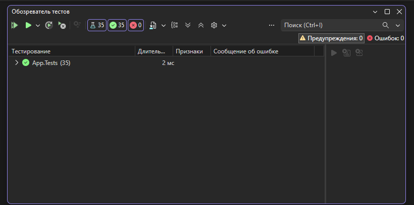

# Результаты проверки

**Дата:** 22.11.2026.  
**Проект:** Консольный калькулятор, Куранов Артем, РПО-3.

## Подтверждённый запуск Microsoft Unit Tests

22.11.2026 автор запустил тесты на своём компьютере в Visual Studio. На предоставленном скриншоте Test Explorer показан следующий результат:

| Показатель | Фактический результат | Подтверждение |
|---|---|---|
| Проект тестов | `App.Tests` | Название группы в Test Explorer |
| Обнаружено тестов | **35** | Общий счётчик и группа `App.Tests (35)` |
| Успешно выполнено | **35** | Зелёный счётчик успешных тестов |
| Неудачных тестов | **0** | Красный счётчик неудачных тестов |
| Предупреждения в Test Explorer | **0** | Надпись «Предупреждения: 0» |
| Ошибки в Test Explorer | **0** | Надпись «Ошибок: 0» |

**Результат: 35 из 35 тестов успешно пройдены (100%).** Это фактический запуск Microsoft Unit Tests в Visual Studio, подтверждённый изображением ниже.



По предыдущему скриншоту использовалась Visual Studio 2026 с выбранными `Debug | x64`. Перед запуском тестов автор сообщил, что пересборка решения завершилась без ошибок. Отдельный журнал MSVC не предоставлялся; счётчики ошибок и предупреждений на этом изображении относятся к Test Explorer.

## Предварительные проверки при подготовке проекта

| Проверка | Среда | Фактический результат |
|---|---|---|
| Сборка приложения из четырёх `.cpp` | Linux, g++ 14.2.0, C++14 | Успешно, ошибок и предупреждений нет |
| Диагностика неопределённого поведения | Та же сборка с UBSan | В выполненных сценариях сообщений UBSan не получено |
| Четыре пары из предыдущего плана | Консольное приложение в Linux | Все результаты и сообщение о делении на ноль совпали с ожиданиями |
| Буквы и выход за диапазон с последующим корректным вводом | Консольное приложение в Linux | Ошибки обнаружены, нужный ввод повторён, затем расчёт выполнен |
| Конец потока до первого и до второго числа | Консольное приложение в Linux | Программа завершилась с кодом 1, без расчёта неполной пары |
| Прямые проверки парсера | Временный проверочный C++-код, g++ | Проверены 12 недопустимых строк, сохранение аргумента при ошибке, границы int, пробелы, знак и повтор ввода |
| Прямые проверки вычислений | Временный проверочный C++-код, g++ | Проверены предельные значения int, расширение арифметики, MIN × MIN и MIN / -1, дробный результат |
| Прямые проверки исключения и текста | Временный проверочный C++-код, g++ | Тип и текст исключения при нуле, основные строки вывода совпали с ожиданиями |
| Структура решения и проектов | Проверка XML и относительных путей | Все перечисленные исходники существуют; main.cpp исключён из тестовой DLL |
| Состав Microsoft Unit Tests | Статическая проверка исходников | 35 уникальных TEST_METHOD: 11 + 16 + 8 |
| Соответствие тестов плану | Сверка имён методов с docs/test-plan.md | Все 35 методов отражены в плане ровно по одному разу |

В консольной проверке выполнено **7 сценариев из 7**: четыре исходные пары, один сценарий исправления букв и слишком большого числа, два сценария конца ввода. Прямые проверки функций выполнены дополнительно и не являются запуском Microsoft Unit Tests.

Команда сборки приложения из корня проекта (Linux, выходной файл в существующем временном каталоге):

```bash
g++ -std=c++14 -Wall -Wextra -Wpedantic -Werror -Wconversion -Wsign-conversion -fsanitize=undefined -fno-sanitize-recover=all -g -I App/include App/main.cpp App/src/input.cpp App/src/calculation.cpp App/src/output.cpp -o /tmp/calculator_checked
```

Ожидания для четырёх исходных пар:

| Первый аргумент | Второй аргумент | Сумма | Разность | Произведение | Частное / сообщение |
|---:|---:|---:|---:|---:|---|
| 5 | 2 | 7 | 3 | 10 | 2.5 |
| -6 | 3 | -3 | -9 | -18 | -2 |
| 0 | 4 | 4 | -4 | 0 | 0 |
| 8 | 0 | 8 | 8 | 0 | На ноль делить нельзя |

## Статус ручной проверки консоли Windows

Отдельный скриншот запуска консольного приложения на Windows не предоставлялся. Успешные тесты подтверждают результаты функций и формируемые строки, но сами по себе не подтверждают отображение кириллицы в конкретном окне консоли.

Для ручной проверки запустить проект `App` через `Ctrl+F5`, ввести `5` и `2` с отдельных строк и проверить читаемость текста и результаты `7`, `3`, `10`, `2.5`. При необходимости приложить скриншот консоли.

## Повторная проверка после изменений

После изменения исходников пересобрать решение и повторно выполнить все тесты через Test Explorer. Обновить дату, фактические результаты и скриншот. Если какой-либо тест не проходит, сохранить его имя и сообщение об ошибке, исправить причину и выполнить повторный прогон.
